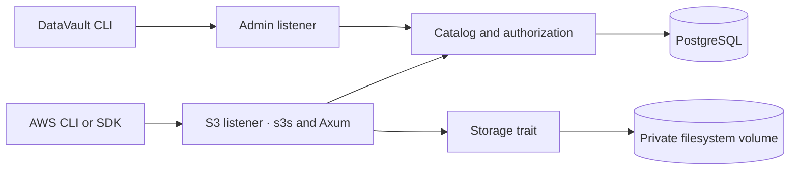

# Architecture

The Cargo workspace contains a framework-independent core, a server, and a management CLI. The core defines bucket and key invariants, permission evaluation, errors, and asynchronous byte-stream storage operations. In the server, the S3 adapter translates wire operations into catalog transactions and storage calls. SQLx queries and migrations live beside the server. The administration module owns its JSON interface. The filesystem implementation accepts UUIDs and never interprets object keys as paths.

## Persistence and concurrency

A PUT authenticates the signing key, checks bucket permissions, and locks the logical key with a transaction-scoped PostgreSQL advisory lock. Each attempt streams into a new temporary file, computes MD5 and SHA-256, syncs the file, atomically renames it into the objects directory, then syncs the directories on Linux. Client checksums and size constraints are validated before SQL publication. The catalog insert or overwrite and its commit precede the success response. The previous physical file remains available for existing readers. Holding the transaction while receiving the stream deliberately bounds active transfers by the size of the connection pool.

GET resolves a committed physical ID, verifies the full SHA-256 digest, then streams the selected range. This adds a sequential read even for small ranges. HEAD checks the stored length. A completed multipart ETag encodes the MD5 of the ordered binary part digests and the part count. The complete object has an independent SHA-256 integrity hash.

Bucket ownership, enabled accounts, active keys, and policy rows are checked inside transactions. A shared bucket lock protects ordinary operations against concurrent deletion. The unique bucket/key index uses C collation for bytewise key ordering. Keyset pagination queries bounded batches and can jump past a complete delimiter group. Concurrent independent listing requests see the then-current catalog.

## Recovery and limits

One filesystem lock and a dedicated PostgreSQL advisory lock guard a running instance. A catalog marker pairs a volume to its database. A startup reference check includes ongoing multipart sessions. Missing referenced files prevent readiness. A failed or uncertain SQL commit leaves immutable files available for reconciliation. Startup counts unreferenced and temporary files. The offline `archive-unused` command moves them into a new recovery directory on the same volume. Operators determine the retention period. An active multipart upload stays referenced until explicitly completed or aborted.

Recovery correctness assumes a single storage service owns the volume and its parent directory. Keep that directory private and use one filesystem for staging and publication. A coherent backup requires a stopped writer or coordinated snapshots. Filesystem sync and a PostgreSQL commit cannot protect against loss of the node or underlying hardware. A restored catalog and filesystem must come from the same recovery point.

## Security

The protocol adapter validates SigV4, including the signed timestamp, service, region, and presigned-URL expiry. DataVault resolves live signing credentials from PostgreSQL and encrypts signing secrets with AES-256-GCM. The public access key is authenticated as associated data. The random master key lives in deployment configuration. Loss of that key requires recovery from backup or issuing replacement credentials.

The administrator token is independent of S3 credentials. Token digests are compared in constant time. Owners control their buckets. Explicit ReadOnly, ReadWrite, or Admin grants apply to a single bucket. Bucket creation is a separate permission granted when the account is created. Object keys are logical UTF-8 identifiers. Payloads and authorization headers are excluded from application request logs.

Audit events record request ID, principal where available, method, path without query, outcome, and peer IP. Audit insertion is best effort following the operation. It does not provide transactional compliance logging. Protect the admin network, backup media, and metrics endpoint.
